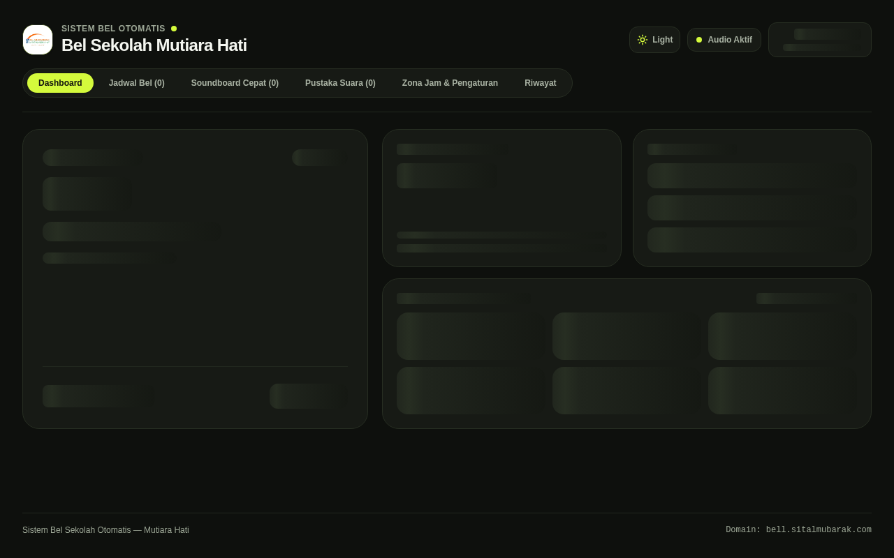

# Bel Sekolah Otomatis & Terjadwal (Smart School Bell)

Aplikasi manajemen bel sekolah otomatis dengan penjadwalan multi-hari, multi-profil (Reguler, Ramadhan, Ujian, Ekstrakurikuler), soundboard manual, pustaka audio sintesis / rekaman, dan dukungan sinkronisasi cloud remote.

Tersedia dalam 2 varian arsitektur:
1. **Cloud Web Service (Live):** Akses browser via reverse-proxy Nginx dengan backend Rust Axum & MySQL.
2. **Desktop Standalone (Windows):** Menggunakan SQLite lokal + Tauri 2, berjalan 100% offline dan tetap membunyikan bel meski koneksi internet/Wi-Fi sekolah terputus, dilengkapi fitur pairing otomatis ke server pusat.

---

## Tampilan Antarmuka Aplikasi



---

## Unduh Aplikasi (Windows MSI Installer)

Installer aplikasi Windows (`.msi`) di-build secara otomatis dan siap diunduh:

👉 **[Klik Di Sini untuk Mengunduh Installer Windows Terbaru](https://github.com/muse727/Bel-Sekolah/actions/runs/20054778330)**

### Langkah Cepat Pengunduhan & Instalasi:
1. Klik link di atas (atau buka tab **[Actions](https://github.com/muse727/Bel-Sekolah/actions)**).
2. Scroll ke bagian paling bawah di panel **Artifacts**.
3. Klik file **`bel-sekolah-windows-msi`** (file `.zip` akan otomatis terunduh).
4. Ekstrak file zip, lalu jalankan file installer `.msi` di komputer Windows.
5. *Catatan:* Jika muncul peringatan *"Windows protected your PC"*, cukup klik **More info** lalu pilih **Run anyway**.

---

## Fitur Utama

- **Otomatisasi Jadwal Bel:** Jadwal fleksibel per hari (Senin–Sabtu) dengan presisi detik.
- **Multi-Profil:** Ganti seluruh pola jadwal dalam 1 klik (misal: saat Ramadhan atau Pekan Ujian).
- **Soundboard Cepat:** Tombol darurat/pengumuman manual (Bel Masuk, Istirahat, Pulang, Upacara, Sirine Darurat).
- **Audio Sintesis & Upload Mandiri:** Dukungan pemutaran MP3/WAV kustom atau audio terintegrasi.
- **Kustomisasi Sekolah:** Ganti nama sekolah dan upload logo sekolah langsung dari dashboard.
- **Tema Gelap & Terang:** Pilihan tema Citron Neon Dark & High-Contrast Light Mode.
- **Pairing & Sinkronisasi:** Komputer sekolah dihubungkan via kode 6-digit ke server pusat (`https://bell.sitalmubarak.com`) untuk pemantauan dan kontrol jarak jauh.

---

## Struktur Direktori Repository

```text
├── backend/          # Backend server pusat (Rust Axum + MySQL)
├── frontend/         # Antarmuka web dashboard (React 19, TypeScript, Tailwind CSS, Vite)
├── desktop/
│   ├── backend/      # Backend standalone desktop (Rust Axum + SQLite)
│   └── app/          # Wrapper desktop native (Tauri 2)
├── database/         # DDL Skema database MySQL
├── audio-assets/     # Master rekaman suara bel & nada pengumuman
├── docs/             # Dokumentasi aset & screenshot preview
└── .github/          # CI/CD workflows untuk auto-build Windows MSI
```

---

## Pengoperasian Pengembangan (Local Development)

### 1. Frontend Web
```bash
cd frontend
npm install
npm run dev
```

### 2. Backend Server (MySQL)
```bash
cd backend
cargo run
```

### 3. Backend Desktop (SQLite)
```bash
cd desktop/backend
cargo run
```
Database SQLite lokal otomatis dibuat di folder `data/bel-sekolah.db`.
